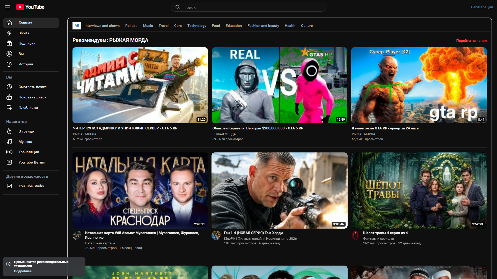
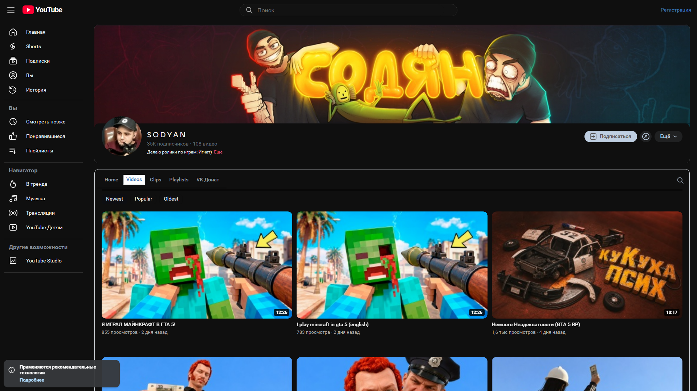

# YouTube в VK Видео

Отдельное расширение для Chrome и других браузеров Chromium: оформляет [VK Видео](https://vkvideo.ru/) и [Кабинет автора](https://cabinet.vkvideo.ru/) в стиле YouTube и YouTube Studio. Видео, подписки, поиск, загрузка и аналитика остаются функциями VK Видео.

## Установка · 0.3.3

- [Установщик Windows](downloads/YouTube-for-VK-Setup-0.3.3.exe) и [файл конфигурации](downloads/YouTube-for-VK-Setup-0.3.3.exe.config) — скачайте оба файла в одну папку и запустите `.exe`. Установщик подготовит папку расширения и откроет страницу расширений браузера.
- [ZIP расширения](downloads/youtube-in-vk-0.3.3.zip) — распакуйте архив, включите режим разработчика на `chrome://extensions` и выберите «Загрузить распакованное расширение». В Edge используйте `edge://extensions`.

После обновления нажмите кнопку обновления на карточке расширения и обновите вкладки VK Видео и Кабинета автора. В окне расширения можно отдельно включить оформление сайта и студии.

## Что изменено

- Шапка, меню, карточки, Shorts, реакции с кнопками «Нравится» и «Не нравится», страница просмотра и Кабинет автора оформлены в стиле YouTube.
- Боковое меню синхронизирует ширину с содержимым страницы. На странице просмотра оно открывается поверх страницы, сохраняя ширину плеера.
- Плеер использует соотношение сторон, которое сообщает штатный плеер VK; полноэкранный режим остаётся функцией VK Видео.
- Поиск получил видимую лупу. Подписки берут настоящие названия каналов из страницы.
- На широком экране главная и страницы каналов показывают три крупные карточки в ряд без пустой четвёртой колонки. Блок с настоящими роликами [канала «РЫЖАЯ МОРДА»](https://vkvideo.ru/@redmuzzlevideo) закреплён перед общей лентой и рядом с плеером. После посещения канала расширение запоминает актуальные ссылки и обложки в локальном хранилище браузера.
- Для роликов этого канала и его панели аналитики просмотры отображаются в увеличенном виде, как в первом расширении. Это **локальная визуальная подмена**: сервер VK, реальные счётчики и алгоритм рекомендаций не меняются. Другой человек увидит такое оформление и ваши ролики только после установки этого расширения.
- Акценты сайта, студии и переключателей оформлены красным цветом YouTube; также исправлен синий цвет ссылочных кнопок VK и текста выбранной вкладки.
- Кабинет автора получил более компактные тёмные панели, скругления и плавные реакции на наведение. Действия загрузки и аналитики остаются штатными.

«Не нравится» сохраняется только локально: VK Видео не предоставляет соответствующую реакцию для отправки на сайт.

## Скриншот



Снимок главной страницы сделан на версии 0.3.1 при ширине окна 1920 пикселей. Он показывает три широкие карточки в ряд и локальный блок роликов канала. [Раздел трансляций версии 0.2.0](docs/live-0.2.0.png).



## Сборка

```text
npm ci
npm run check
npm run build
npm test
dotnet build installer/YouTubeForVk.Setup.csproj -c Release -r win-x64
```

Готовая папка расширения — `dist/`. Установщик требует .NET Framework 4.8, присутствующий на большинстве современных Windows.
